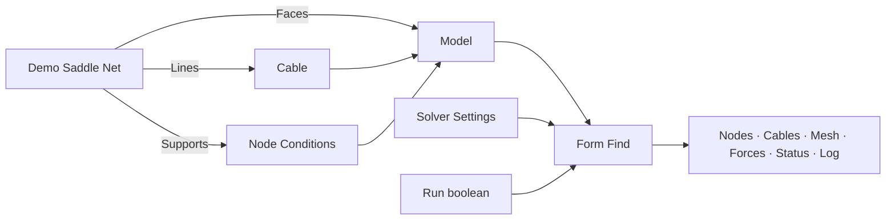

# Arachne

Primo progetto Grasshopper dedicato alla ricerca di forma di reti di cavi e membrane, estratto dal percorso di form finding di FeMM. Il modello usa **metri, newton, chilogrammi e secondi**. SAP, Straus, ETABS e il modello FEM generale di FeMM non sono dipendenze di Arachne.

**Stato:** Arachne compila con TensileLib GPC e le DLL locali. Il collegamento reale supera i test di equilibrio lineare, iterativo e non lineare. Vedere [registro modifiche](docs/CHANGELOG.md) per verifiche e limiti.

## Struttura

```text
Arachne.sln
src/
  Arachne.Core/           Modello, validazione, controllo iterazioni, adattatore TensileLib
  Arachne.Grasshopper/    Componenti .gha e generatori geometrici derivati da FeMM
tests/Arachne.Core.Tests/ Controlli eseguibili senza Rhino e senza TensileLib
tools/Arachne.ExampleWriter/ Generatore del documento di esempio, mediante Rhino
examples/                Primo schema Grasshopper
lib/                     Posizione prevista per TensileLib.dll
scripts/build.ps1         Compilazione, controlli e raccolta del plugin
docs/                    Architettura e note sulle correzioni
```

## Primo schema

Aprire [01_SaddleNet.gh](examples/01_SaddleNet.gh) dopo aver caricato il plugin. È disponibile anche la versione XML [01_SaddleNet.ghx](examples/01_SaddleNet.ghx). Entrambe contengono componenti collegati, con Run disattivato.



Nel caso dimostrativo, collegare tutti i bordi della rete a Node Conditions con X, Y e Z bloccati. Usare Target = 1 N/m in Cable e il solutore Linear. La rete predefinita ha 25 nodi, 40 cavi, 16 facce e 16 nodi di bordo vincolati. Le quote del bordo definiscono una sella; i nodi interni partono da quota zero. Impostare **Run = False** durante la preparazione.

Con TensileLib assente, Run = True deve dare `DependencyMissing`, con geometria di risultato vuota. La geometria iniziale resta visibile dall'uscita Model. I tipi intermedi sono dati transitori ricalcolati dai componenti: usare i collegamenti, non copie internalizzate del modello o dei cavi.

## Componenti

| Gruppo | Componenti |
|---|---|
| 0 Geometry | Demo Saddle Net, Cable Net, Radial Cable Net, Compound Net |
| 1 Model | Cable, Cable Constraints, Cable Load, Node Conditions, Model |
| 2 Form Finding | Solver Settings, Form Find |

Cable espone densità di forza, forza nel cavo, membrana e curvatura; distingue trama e ordito e consente pesi non lineari. Cable Constraints gestisce lunghezza, forza assiale e compensazione percentuale. Cable Load applica una forza concentrata in una frazione della lunghezza: per carichi distribuiti serve fornire la risultante e la posizione corretta. Node Conditions unisce vincoli, forze nodali e pesi per mantenere la posizione. Per caricare un nodo libero disattivare i tre vincoli.

Le coordinate e la tolleranza di Model devono essere in metri: non viene eseguita una conversione automatica dalle unità del documento Rhino. Area e densità dei cavi servono al peso proprio; la massa superficiale di una membrana non è ancora un ingresso dedicato.

Per una rete ottenuta con i generatori FeMM, unire le linee di trama, ordito e bordo necessarie alla topologia, senza duplicati. Appiattire gli ingressi di Model se si desidera un solo modello. Nei generatori è richiesto un perimetro chiuso. Compound Net usa rami `{0}`, `{1}`, ... per le diverse porzioni di rete.

## Compilazione

Prerequisiti di questa prima configurazione: Windows, SDK .NET 8 o successivo, Rhino 8 installato, DLL GPC locali. Il plugin usa il target `net48`; la compilazione non certifica il caricamento nelle diverse modalità runtime di Rhino.

```powershell
.\scripts\build.ps1
```

Il plugin e le sue dipendenze vengono raccolti in `artifacts/Release/Arachne`. Copiare l'intera cartella nelle Libraries di Grasshopper e riavviare Rhino. Il progetto non esegue installazioni automatiche nelle cartelle di Rhino. Le DLL locali usate nella prima compilazione sono GPCGeometry 2.1.0.3 e GPCUtilities 2.0.0.8.

I percorsi predefiniti, modificabili tramite proprietà MSBuild o parametri dello script, sono:

| Proprietà | Percorso rispetto alla cartella Arachne |
|---|---|
| GpcGeometryPath | `../Geometry/GPCGeometry/bin/Release/netstandard2.0/GPCGeometry.dll` |
| GpcUtilitiesPath | `../Utilities/GPCUtilities/bin/Release/netstandard2.0/GPCUtilities.dll` |
| TensileLibPath | `../tensilelib/TensileLib/bin/Release/TensileLib.dll` |
| RhinoSystemDir | `C:/Program Files/Rhino 8/System` |
| GrasshopperDir | `C:/Program Files/Rhino 8/Plug-ins/Grasshopper` |

## Motore TensileLib

Compilare prima `../tensilelib/TensileLib.sln` in Release, poi eseguire `./scripts/build.ps1 -RequireTensile`. I percorsi possono essere cambiati con i parametri dello script. Core e test usano net48, coerente con il motore net472 e il plugin Grasshopper.

Il pacchetto include TensileLib, alglibnet2, GPCGeometry, GPCUtilities, MathNet.Numerics e System.Drawing.Common. La tolleranza algebrica B deve essere 0; A=0 e AI=0 scelgono i default del motore (1e-5 e 10000). Create mesh disattivato sopprime l'output mesh, ma il motore puo generare facce interne.

Il riferimento teorico indicato e Shell Structures for Architecture: Form Finding and Optimization (Routledge, 2014), capitoli 6 e 12. I casi con membrane, pressioni, peso proprio e vincoli combinati richiedono ulteriori confronti dedicati.

Vedere [architettura](docs/ARCHITECTURE.md), [porting](docs/PORTING.md) e [registro modifiche](docs/CHANGELOG.md).