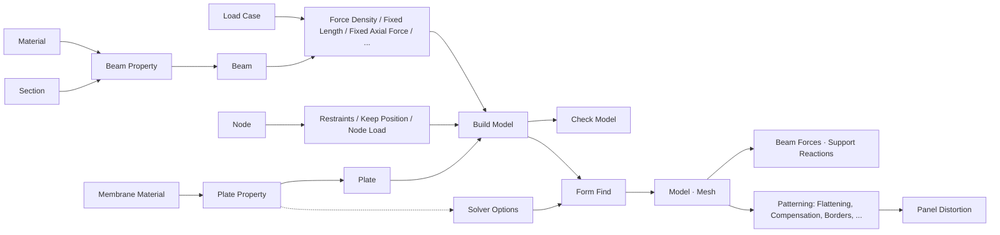

# Arachne

Plug-in Grasshopper per il form finding e il patterning di tele e tensostrutture. Contiene i componenti di FeMM dedicati a questi due temi, con gli stessi ingressi e uscite tranne lo snellimento (dati SAP tolti, opzioni del Form Find in Solver Options); i GUID sono nuovi, così i due plug-in si possono caricare insieme. Sono corretti i bug trovati durante il trasferimento ([dettagli](docs/PORTING.md)). Componenti nuovi: Membrane Material, Solver Options, Check Model, Beam Forces, Support Reactions e Panel Distortion.

**Versione:** 0.3.0-rc.5 (DLL 0.3.0.5). Si lavora in N e mm. Motore di form finding: TensileLib 2.5 (`../tensilelib`). Sviluppo dei pannelli ARAP: motore C# `Arachne.Arap` ([resoconto](docs/ARAP-REWRITE.md)).

## Struttura

```text
Arachne.sln
Arachne.Arap.sln             Soluzione autonoma del motore ARAP e dei suoi test
src/
  Arachne.Common/            Modello FEM e helper di FeMM.Common usati dal form finding
  Arachne.Grasshopper/       Componenti, data type e parametri (.gha)
  Arachne.Arap/              Motore ARAP C# netstandard2.0
tests/Arachne.Arap.Tests/    Verifiche numeriche del motore ARAP
tools/Arachne.ExampleWriter/ Verifiche in Rhino/Grasshopper senza finestra, esempi e icone
examples/                    Definizioni GH e GHX
scripts/                     Compilazione, verifiche, pacchetto ed esempi
docs/                        Provenienza, architettura, ARAP, registro modifiche
```

## Flusso di lavoro

È quello di FeMM: gli elementi del modello ricevono gli attributi di form finding, Build Model li assembla e Form Find calcola la forma.



Note d'uso, come in FeMM:

- **Unità:** si lavora in N e mm, il predefinito di Build Model (Nmm). Le dimensioni delle sezioni sono nelle unità del modello (mm), le densità di forza in N/mm e la gravità di Solver Options, se si vuole il peso proprio, vale 9806.65 mm/s². Le tolleranze di Solver Options sono relative; TensileLib risolve il modello centrato nell'origine, quindi le coordinate di cantiere non peggiorano la convergenza né la precisione.
- **Rami:** collegare a Build Model tutti gli elementi in un'unica lista, appiattendo l'ingresso Elements se arrivano da percorsi diversi. Gli elementi con lo stesso GUID (per esempio una Beam passata da Force Density e da Fixed Length) vengono uniti.
- **Fusione dei nodi:** due nodi più vicini di 0.001 (unità del modello) vengono uniti con attributi e carichi. FeMM leggeva questa tolleranza dalle opzioni del suo plug-in Rhino.
- **Form Find:** calcola con il pulsante **Run** oppure con Auto Run = True. Gravità, pressione, casi di carico, iterazioni, tolleranze e mesh si danno con Solver Options; senza, valgono i predefiniti. Load Cases sceglie i casi dei carichi nodali e sulle aste da applicare (vuoto: tutti).
- **Peso proprio:** con Gravity diversa da 0 pesano le aste (area × densità della sezione) e le piastre con una Plate Property (spessore × densità; per un Membrane Material il peso in g/m² della scheda). Le piastre generate dalle aste prendono il Plate Property di Solver Options. La pressione richiede un Load Case, a cui vengono assegnati i carichi nodali risultanti; una pressione positiva agisce secondo la normale dell'ingresso Plane (+Z con il piano predefinito). Quei carichi nodali sono un risultato, come i pre-carichi: se il modello calcolato passa a un altro Form Find, non vengono applicati di nuovo (la pressione di Solver Options agisce sulla nuova forma) e vengono sostituiti. I solutori Linear e Non-Linear pubblicano il risultato anche al limite di iterazioni, con un avviso. Linear step by step si ferma invece con un errore.
- **Vincoli:** Restraints vincola le traslazioni lungo X, Y, Z oppure, con un piano nell'ingresso Coordinate System, lungo gli assi X e Y del piano e la sua normale Z. Per esempio, un nodo che scorre su una retta inclinata è vincolato in Y e Z con l'asse X del piano lungo la retta; un nodo su un piano inclinato è vincolato solo in Z. Le rotazioni di FeMM non ci sono più, perché il form finding non le usa.
- **Risultati:** il modello calcolato contiene le forze assiali delle aste (pre-carichi, come in FeMM) e, se il calcolo converge, le reazioni dei vincoli, solo nelle direzioni vincolate. Beam Forces e Support Reactions le estraggono.
- **Carichi sulle aste:** solo forze, uniformi o trapezie, in un sistema globale o in un Coordinate System; sono ripartite sui nodi con la regola della leva e restano alla stessa frazione della lunghezza quando l'asta si allunga.
- **Filtri:** Node, Beam e Plate Filter cercano per ID gli identificativi assegnati con Element Id.
- **Cable Net:** Warp, Weft e Restraint edges sono alberi con un ramo per cavo. Appiattirli prima di Beam.

## Componenti

| Pannello | Componenti |
| --- | --- |
| 01-Parameters | CoordinateSystem |
| 02-Materials | Aluminium, Concrete, Custom Material, Steel, *Membrane Material* |
| 03-Sections | Angle, Brep, C, Generic, Hollow Circle, Hollow Rect, I, Solid Circle, Solid Rect, T, Section Geometric Property |
| 04-Definitions | Load Case, Group |
| 05-Properties | Beam Property, Plate Property |
| 06-Model | Node, Beam, Plate |
| 07-Attributes | Force Density, Fixed curvature cable, Membrane type, Fixed Length, Fixed Axial Force, Fixed compensation, Keep Position, Restraints, Element Id |
| 08-Loads | Node Load, Beam Point Load, Beam Distributed Load |
| 09-Model | Build Model, Decompose Model, *Check Model* |
| 12-Analysis | Form Find, *Solver Options*, *Beam Forces*, *Support Reactions* |
| 13-Patterning | Borders, OrderBorders, Compensation, Decompensation, DecompensationDescriptor, DecompensationDescriptorExt, Flattening, Flattening ARAP, Deform ARAP, Geodesic Offsets, Line-Up, Mesh Clean, Mesh Divide, Mesh Geodesic, Mesh Remap, Remesh, Split Mesh On Curves, Subdivide Mesh, Unweld Mesh, *Panel Distortion* |
| 14-Tools | Cable Net, Radial Cable Net, Compound Net, Curve2Mesh, Node Filter, Beam Filter, Plate Filter |

Le sezioni servono al peso proprio (area) e all'anteprima delle aste, disegnate con la loro sezione. In corsivo i componenti nuovi di Arachne, che non esistono in FeMM. La tabella con sorgente FeMM e GUID di ogni componente è in [PORTING.md](docs/PORTING.md); le icone sono in [ICONS.svg](docs/ICONS.svg).

## Esempi

[01_SaddleNet](examples/01_SaddleNet.gh) (sella con vincoli al bordo, con Check Model, Beam Forces e Support Reactions), [02_Patterning](examples/02_Patterning.gh) (sviluppo, compensazione, bordi e decompensazione di un pannello) e [03_CableNet](examples/03_CableNet.gh) (rete generata da Cable Net). Ogni file esiste anche in GHX. Vedere [examples/README.md](examples/README.md).

## Compilazione e verifiche

Prerequisiti: Windows x64, SDK .NET 8 o successivo, .NET Framework 4.8 Developer Pack, Rhino 8, DLL Release di GPCGeometry, GPCUtilities e TensileLib nei repository adiacenti.

```powershell
.\scripts\build.ps1 -RhinoTests
```

Gli output della compilazione stanno nella cartella `bin` alla radice, in `bin/<progetto>/<configurazione>/<framework>`; i file intermedi restano nella cartella `obj` di ogni progetto, perché contengono una copia del `.gha`. Lo script esegue i test del motore ARAP. Con `-RhinoTests` avvia Rhino senza finestra ed esegue le verifiche Grasshopper:

- ingressi e uscite di ogni componente confrontati con i sorgenti FeMM;
- GUID e icone;
- form finding su casi analitici;
- patterning e reti.

Il plug-in è la cartella `bin/Arachne.Grasshopper/Release/net48`: `.gha` e DLL necessarie, con `DEPENDENCIES.json` (versioni e SHA-256) e `BUILD.json` (commit e verifiche eseguite, scritto solo se tutte le verifiche passano). Per installarlo, copiare la cartella nelle Libraries di Grasshopper.

Se Grasshopper carica il plug-in dalla cartella `bin`, chiudere Rhino prima di compilare e compilare solo in Release. Grasshopper cerca i `.gha` anche nelle sottocartelle, quindi sotto `bin` deve essercene uno solo: una build Debug ne aggiungerebbe un secondo. Per lo stesso motivo ExampleWriter non copia il `.gha` nella sua cartella e lo carica da `bin/Arachne.Grasshopper`. Per verificare una build con Rhino aperto si compila fuori dal repository, con la proprietà `ArachneBin` (`dotnet build Arachne.sln -c Release -p:ArachneBin=<cartella>\`), e si lanciano le verifiche da lì.

Percorsi predefiniti, modificabili con proprietà MSBuild o parametri dello script:

| Proprietà | Percorso rispetto alla cartella Arachne |
| --- | --- |
| GpcGeometryPath | `../Geometry/GPCGeometry/bin/Release/netstandard2.0/GPCGeometry.dll` |
| GpcUtilitiesPath | `../Utilities/GPCUtilities/bin/Release/netstandard2.0/GPCUtilities.dll` |
| TensileLibPath | `../tensilelib/TensileLib/bin/Release/TensileLib.dll` |
| RhinoSystemDir | `C:/Program Files/Rhino 8/System` |
| GrasshopperDir | `C:/Program Files/Rhino 8/Plug-ins/Grasshopper` |

Altri script: `scripts/build-examples.ps1` rigenera gli esempi e `docs/ICONS.svg`; `scripts/build-arap.ps1` compila solo il motore ARAP; `scripts/build-native.ps1` ricompila in `bin/Arachne.IGL/Release` la vecchia DLL nativa, usata solo per i confronti facoltativi del motore ARAP. Per le icone dei nuovi componenti aggiungere il disegno in `tools/Arachne.ExampleWriter/IconArtwork.cs` ed eseguire ExampleWriter con `--icons`.

Vedere anche [architettura](docs/ARCHITECTURE.md) e [registro modifiche](docs/CHANGELOG.md).
