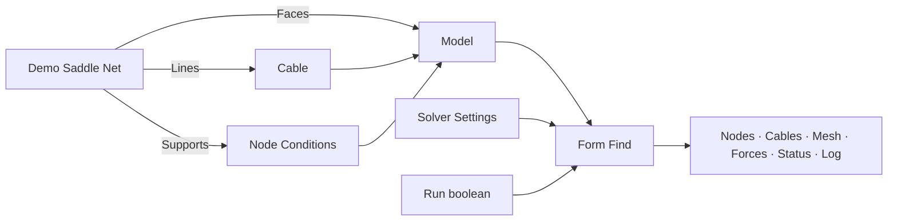

# Arachne

Primo progetto Grasshopper dedicato alla ricerca di forma di reti di cavi e membrane, estratto dal percorso di form finding di FeMM. Il modello usa **metri, newton, chilogrammi e secondi**. SAP, Straus, ETABS e il modello FEM generale di FeMM non sono dipendenze di Arachne.

**Stato:** il progetto compila con le DLL locali GPCGeometry e GPCUtilities. Il motore TensileLib non è ancora disponibile: i componenti geometrici e di modellazione sono utilizzabili, mentre Form Find restituisce `DependencyMissing` e non produce una forma calcolata. L'adattatore TensileLib è predisposto sui metodi osservati in FeMM, ma il suo ramo di codice non è ancora compilato né validato con la DLL reale.

## Struttura

```text
Arachne.sln
src/
  Arachne.Core/           Modello, validazione, controllo iterazioni, adattatore TensileLib
  Arachne.Grasshopper/    Componenti .gha e generatori geometrici derivati da FeMM
tests/Arachne.Core.Tests/ Controlli eseguibili senza Rhino e senza TensileLib
tools/Arachne.ExampleWriter/ Generatore del documento di esempio, mediante Rhino
examples/                Primo schema Grasshopper
lib/                     Posizione prevista per TensileLib.dll
scripts/build.ps1         Compilazione, controlli e raccolta del plugin
docs/                    Architettura e note sulle correzioni
```

## Primo schema

Aprire [01_SaddleNet.gh](examples/01_SaddleNet.gh) dopo aver caricato il plugin. È disponibile anche la versione XML [01_SaddleNet.ghx](examples/01_SaddleNet.ghx). Entrambe contengono componenti collegati, con Run disattivato.



Nel caso dimostrativo, collegare tutti i bordi della rete a Node Conditions con X, Y e Z bloccati. Usare Target = 1 N/m in Cable e il solutore Linear. La rete predefinita ha 25 nodi, 40 cavi, 16 facce e 16 nodi di bordo vincolati. Le quote del bordo definiscono una sella; i nodi interni partono da quota zero. Impostare **Run = False** durante la preparazione.

Con TensileLib assente, Run = True deve dare `DependencyMissing`, con geometria di risultato vuota. La geometria iniziale resta visibile dall'uscita Model. I tipi intermedi sono dati transitori ricalcolati dai componenti: usare i collegamenti, non copie internalizzate del modello o dei cavi.

## Componenti

| Gruppo | Componenti |
|---|---|
| 0 Geometry | Demo Saddle Net, Cable Net, Radial Cable Net, Compound Net |
| 1 Model | Cable, Cable Constraints, Cable Load, Node Conditions, Model |
| 2 Form Finding | Solver Settings, Form Find |

Cable espone densità di forza, forza nel cavo, membrana e curvatura; distingue trama e ordito e consente pesi non lineari. Cable Constraints gestisce lunghezza, forza assiale e compensazione percentuale. Cable Load applica una forza concentrata in una frazione della lunghezza: per carichi distribuiti serve fornire la risultante e la posizione corretta. Node Conditions unisce vincoli, forze nodali e pesi per mantenere la posizione. Per caricare un nodo libero disattivare i tre vincoli.

Le coordinate e la tolleranza di Model devono essere in metri: non viene eseguita una conversione automatica dalle unità del documento Rhino. Area e densità dei cavi servono al peso proprio; la massa superficiale di una membrana non è ancora un ingresso dedicato.

Per una rete ottenuta con i generatori FeMM, unire le linee di trama, ordito e bordo necessarie alla topologia, senza duplicati. Appiattire gli ingressi di Model se si desidera un solo modello. Nei generatori è richiesto un perimetro chiuso. Compound Net usa rami `{0}`, `{1}`, ... per le diverse porzioni di rete.

## Compilazione

Prerequisiti di questa prima configurazione: Windows, SDK .NET 8 o successivo, Rhino 8 installato, DLL GPC locali. Il plugin usa il target `net48`; la compilazione non certifica il caricamento nelle diverse modalità runtime di Rhino.

```powershell
.\scripts\build.ps1
```

Il plugin e le sue dipendenze vengono raccolti in `artifacts/Release/Arachne`. Copiare l'intera cartella nelle Libraries di Grasshopper e riavviare Rhino. Il progetto non esegue installazioni automatiche nelle cartelle di Rhino. Le DLL locali usate nella prima compilazione sono GPCGeometry 2.1.0.3 e GPCUtilities 2.0.0.8.

I percorsi predefiniti, modificabili tramite proprietà MSBuild o parametri dello script, sono:

| Proprietà | Percorso rispetto alla cartella Arachne |
|---|---|
| GpcGeometryPath | `../Geometry/GPCGeometry/bin/Release/netstandard2.0/GPCGeometry.dll` |
| GpcUtilitiesPath | `../Utilities/GPCUtilities/bin/Release/netstandard2.0/GPCUtilities.dll` |
| TensileLibPath | `lib/TensileLib.dll` |
| RhinoSystemDir | `C:/Program Files/Rhino 8/System` |
| GrasshopperDir | `C:/Program Files/Rhino 8/Plug-ins/Grasshopper` |

## Quando arriva TensileLib

1. Copiare `TensileLib.dll` in `lib`, oppure indicare `-TensileLibPath` allo script.
2. Compilare con `.\scripts\build.ps1 -RequireTensile`. La presenza della DLL attiva il ramo reale dell'adattatore: eventuali incompatibilità devono emergere in compilazione.
3. Verificare le dipendenze e le firme effettive della DLL. Il progetto FeMM usava TensileLib 2.0.6 con tipi `Maffeis.Geometry`. Questa versione di Arachne usa **GPC.Geometry**: rinominare una DLL non rende compatibili le due identità. Se TensileLib richiede MaffeisGeometry, servirà una build di TensileLib per GPC oppure una revisione esplicita dell'integrazione.
4. Eseguire confronti numerici con FeMM: rete a densità costante, carichi nodali, lunghezza/forza imposta, membrana, pressione e peso proprio. I controlli attuali non sostituiscono questi confronti.

Ulteriori dipendenze transitive della DLL si potranno verificare solo quando sarà disponibile. Non sono stati creati solutori sostitutivi o DLL fittizie.

Per i dettagli vedere [architettura](docs/ARCHITECTURE.md) e [porting e correzioni](docs/PORTING.md).
