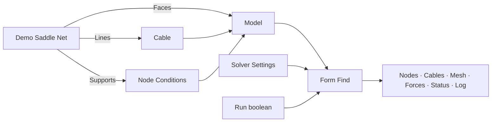

# Arachne

Primo progetto Grasshopper dedicato alla ricerca di forma di reti di cavi e membrane, estratto dal percorso di form finding di FeMM. Il modello usa **metri, newton, chilogrammi e secondi**. SAP, Straus, ETABS e il modello FEM generale di FeMM non sono dipendenze di Arachne.

**Stato:** release candidata 0.2.0-rc.2, con motore ARAP C# autonomo, 43 componenti e TensileLib GPC 2.1.0.0. Include tutti i 22 componenti della cartella Patterning di FeMM e 13 componenti per risultati e diagnostica. Sono disponibili [cinque nuovi esempi completi](docs/FIVE-EXAMPLES.md), con copertura di tutti i componenti, solver iterativo/non lineare e [nuove icone](docs/ICONS.svg). Vedere anche [resoconto ARAP](docs/ARAP-REWRITE.md), [API della libreria](src/Arachne.Arap/README.md), [prima release](docs/RELEASE-1.md), [risultati](docs/RESULTS.md) e [storico della migrazione](docs/RESOCONTO.md).

## Struttura

```text
Arachne.sln
Arachne.Arap.sln          Soluzione autonoma: libreria e test, senza Rhino/FEM
src/
  Arachne.Arap/           Motore ARAP C# netstandard2.0 indipendente, geometria GPC
  Arachne.Core/           Modello, validazione, controllo iterazioni, adattatore TensileLib
  Arachne.Grasshopper/    Componenti .gha e generatori geometrici derivati da FeMM
tests/Arachne.Core.Tests/ Controlli del modello ed equilibri reali, senza Rhino
tools/Arachne.ExampleWriter/ Prove dei componenti e generatore degli esempi, mediante Rhino
examples/                Ricerca di forma e sviluppo pannelli, GH e GHX
lib/                     Eventuali DLL locali con percorsi configurati
scripts/build.ps1         Compilazione, controlli e raccolta del plugin
scripts/build-examples.ps1 Cinque esempi GH/GHX, calcolo e verifica dopo riapertura
bin/                     Output centralizzati per progetto, configurazione e framework
docs/                    Architettura e note sulle correzioni
```

## Primo schema

Aprire [01_SaddleNet.gh](examples/01_SaddleNet.gh) dopo aver caricato il plugin. È disponibile anche la versione XML [01_SaddleNet.ghx](examples/01_SaddleNet.ghx). Entrambe contengono componenti collegati, con Run disattivato.



Nel caso dimostrativo, collegare tutti i bordi della rete a Node Conditions con X, Y e Z bloccati. Usare Target = 1 N/m in Cable e il solutore Linear. La rete predefinita ha 25 nodi, 40 cavi, 16 facce e 16 nodi di bordo vincolati. Le quote del bordo definiscono una sella; i nodi interni partono da quota zero. Impostare **Run = False** durante la preparazione.

Il plugin completo richiede TensileLib; ARAP viene compilato dal nuovo progetto C# autonomo. Il solo Core mantiene la modalita senza motore per la diagnostica. I tipi intermedi sono dati transitori ricalcolati dai componenti: usare i collegamenti, non copie internalizzate del modello, dei descrittori o dei cavi.

[02_Patterning.gh](examples/02_Patterning.gh) contiene un pannello inclinato, Flattening, ARAP alternativo, Compensation 2%/1%, Borders, OrderBorders, descrittori neutri, Decompensation e Line-Up. Anche la versione [GHX](examples/02_Patterning.ghx) e stata riaperta e ricalcolata.

## Componenti

| Gruppo | Componenti |
|---|---|
| 0 Geometry | Demo Saddle Net, Cable Net, Radial Cable Net, Compound Net |
| 1 Model | Cable, Cable Constraints, Cable Load, Node Conditions, Model, Check Model, Deconstruct Model, Unit Settings, Convert Units |
| 2 Form Finding | Solver Settings, Form Find (anche in background) |
| 3 Patterning | Borders, OrderBorders, Compensation, Decompensation, DecompensationDescriptor, DecompensationDescriptorExt, Flattening, Flattening ARAP, Deform ARAP, Geodesic Offsets, Mesh Divide, Mesh Geodesic, Mesh Clean, Mesh Pipe, Mesh Remap, Split Mesh On Curves, Subdivide Mesh, Unweld Mesh, Line-Up, Panel Distortion |
| 4 Results | Deconstruct Result, Node Results, Beam Results, Plate Results, Equilibrium Report, Solver History, Result Preview |
| 0 Utilities | Dependency Check |

Cable espone densità di forza, forza nel cavo, membrana e curvatura; distingue trama e ordito e consente pesi non lineari. Cable Constraints gestisce lunghezza, forza assiale e compensazione percentuale. Cable Load applica una forza concentrata in una frazione della lunghezza: per carichi distribuiti serve fornire la risultante e la posizione corretta. Node Conditions unisce vincoli, forze nodali e pesi per mantenere la posizione. Per caricare un nodo libero disattivare i tre vincoli.

Le coordinate e la tolleranza di Model devono essere in metri: non viene eseguita una conversione automatica dalle unità del documento Rhino. Area e densità dei cavi servono al peso proprio; la massa superficiale di una membrana non è ancora un ingresso dedicato.

Per una rete ottenuta con i generatori FeMM, unire le linee di trama, ordito e bordo necessarie alla topologia, senza duplicati. Appiattire gli ingressi di Model se si desidera un solo modello. Nei generatori è richiesto un perimetro chiuso. Compound Net usa rami `{0}`, `{1}`, ... per le diverse porzioni di rete.

## Compilazione

Prerequisiti: Windows x64, SDK .NET 8 o successivo, .NET Framework 4.8 Developer Pack, Rhino 8 installato e utilizzabile, DLL GPC e TensileLib Release locali. Non occorrono Visual Studio C++, libigl/Eigen o DLL native per ARAP. Il plugin usa `net48`; i test sono eseguiti in Rhino in-process con .NET Framework, non in tutte le modalita runtime di Rhino.

```powershell
.\scripts\build.ps1 -RequireTensile -RhinoTests
```

Ogni compilazione, anche da Visual Studio o direttamente tramite `dotnet build`, crea gli output in `bin/<nome progetto>/<Debug|Release>/<framework>` alla radice del repository. Per esempio il plugin e in `bin/Arachne.Grasshopper/Release/net48` e la libreria ARAP in `bin/Arachne.Arap/Release/netstandard2.0`. Le cartelle `bin` nei singoli progetti non vengono piu create. La configurazione comune e in `Directory.Build.props`; i file intermedi rimangono nelle cartelle `obj` dei progetti.

Il plugin e le sue dipendenze vengono raccolti in `artifacts/Release/Arachne`. Copiare l'intera cartella nelle Libraries di Grasshopper e riavviare Rhino. Il progetto non esegue installazioni automatiche nelle cartelle di Rhino. Le DLL locali usate nella prima compilazione sono GPCGeometry 2.1.0.3 e GPCUtilities 2.0.0.8.

I percorsi predefiniti, modificabili tramite proprietà MSBuild o parametri dello script, sono:

| Proprietà | Percorso rispetto alla cartella Arachne |
|---|---|
| GpcGeometryPath | `../Geometry/GPCGeometry/bin/Release/netstandard2.0/GPCGeometry.dll` |
| GpcUtilitiesPath | `../Utilities/GPCUtilities/bin/Release/netstandard2.0/GPCUtilities.dll` |
| TensileLibPath | `../tensilelib/TensileLib/bin/Release/TensileLib.dll` |
| NativeIglPath (solo test facoltativi) | `artifacts/native/Release/Arachne.IGL.dll`, confronto con il motore precedente |
| RhinoSystemDir | `C:/Program Files/Rhino 8/System` |
| GrasshopperDir | `C:/Program Files/Rhino 8/Plug-ins/Grasshopper` |

## Motore TensileLib

Compilare prima `../tensilelib/TensileLib.sln` in Release, poi eseguire `./scripts/build.ps1 -RequireTensile`. I percorsi possono essere cambiati con i parametri dello script. Core e test usano net48, coerente con il motore net472 e il plugin Grasshopper.

Il pacchetto include TensileLib, alglibnet2, GPCGeometry, GPCUtilities, MathNet.Numerics, System.Drawing.Common e Arachne.Arap. ARAP usa esclusivamente il nuovo motore gestito; la distribuzione non contiene Arachne.IGL.dll. La tolleranza algebrica B deve essere 0; A=0 e AI=0 scelgono i default del motore (1e-5 e 10000). Create mesh disattivato sopprime l'output mesh, ma il motore puo generare facce interne e queste rimangono interrogabili.

Il riferimento teorico indicato e Shell Structures for Architecture: Form Finding and Optimization (Routledge, 2014), capitoli 6 e 12. Sono verificati pressione, peso proprio, carichi concentrati e trasferimento degli obiettivi di membrana su casi analitici. Il confronto teorico completo e i casi di produzione restano da eseguire. I tiri di bordo delle piastre sono forze delle aste in N: non sono disponibili Nx/Ny/Nxy della membrana.

Vedere [architettura](docs/ARCHITECTURE.md), [porting](docs/PORTING.md) e [registro modifiche](docs/CHANGELOG.md).

## Libreria ARAP autonoma e uso dei risultati

Per compilare solo ARAP usare `./scripts/build-arap.ps1`; il pacchetto e in `artifacts/Release/Arachne.Arap`. Il parametro facoltativo `-CompareNative` confronta anche la DLL precedente, se presente. `scripts/build-native.ps1` rimane come strumento per ricostruire il solo riferimento storico dei test.

Flattening ARAP e Deform ARAP conservano GUID, ingressi e uscita mesh originale. Le nuove uscite mostrano stato, report, energia e distorsione; Flattening ARAP mostra anche l'errore del perimetro. Le mesh non convergenti, invertite o degeneri non vengono pubblicate. ARAP usa le unita della mesh, compresa la tolleranza del perimetro.

Per aggiornare il plugin, sostituire l'intera cartella della distribuzione precedente. La vecchia Arachne.IGL.dll non serve piu. La verifica `--tests-only` non scrive gli esempi. I pacchetti contengono i manifest di build e delle DLL.

Collegare Result o Solved model di Form Find a Node Results, Beam Results e Plate Results. Deconstruct Model legge il modello iniziale; Deconstruct Result separa lo stato iniziale dalla configurazione risolta. Per equilibrio, unita, segni, tiri di bordo e conservazione in memoria leggere [RESULTS.md](docs/RESULTS.md).

La pressione segue ora l'orientamento delle facce e include i carichi sui nodi di bordo. Per calcoli lunghi attivare Background; Cancel interrompe ai punti di controllo interni, mentre Run=False annulla e svuota. Patterning e ARAP rimangono sincroni.
