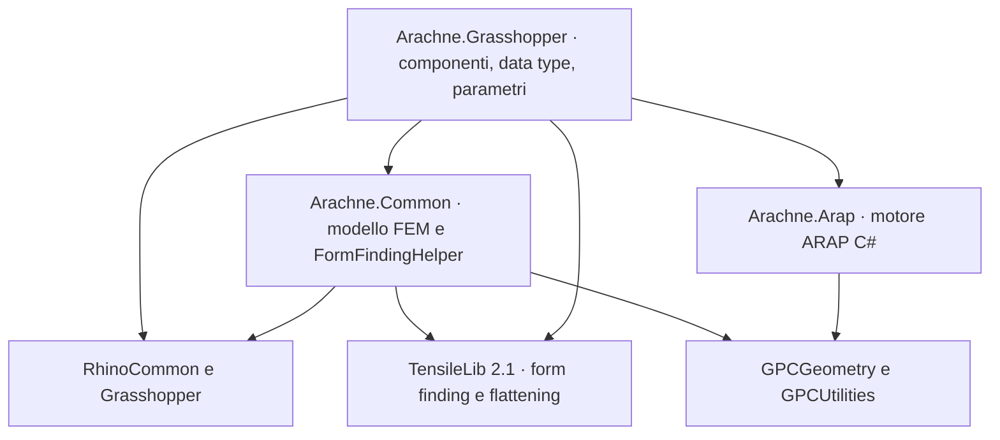

# Architettura

## Arachne.Common

Porting di FeMM.Common limitato a ciò che serve al form finding:

- `Models`: modello FEM (`ModelModel`, nodi, aste, piastre), attributi (vincoli, pesi, ID), carichi (nodali, sulle aste, pre-carico), attributi di form finding (`ForceDensityModel`, `FixedLengthModel`, `FixedAxialForceModel`), casi e combinazioni di carico, proprietà, sezioni e materiali.
- `Helpers/FormFindingHelper`: converte il modello FEM nel modello TensileLib (nodi, aste, piastre, carichi, obiettivi) e genera mesh da reti di curve.
- `Helpers/ModelHelper`: conversioni di unità tramite GPCUtilities (ex Maffeis.Utilities).
- `Geometry/Shapes`: forme generiche delle sezioni, su GPCGeometry (ex Maffeis.Geometry).

I modelli sono serializzabili in binario (.NET Framework 4.8). Lo stesso formato serve per i dati interni dei parametri Grasshopper e per le copie profonde.

## Arachne.Grasshopper

- `DataTypes`: wrapper Grasshopper dei modelli (`GH_Model`, `GH_Node`, `GH_Beam`, `GH_Plate`, proprietà, sezioni, materiali, casi e combinazioni di carico). Ogni nodo, asta e piastra ha un GUID. Build Model unisce gli elementi con lo stesso GUID e poi i nodi coincidenti entro la tolleranza delle impostazioni (`Settings`, 0.001).
- `Components`: un file per componente, nelle cartelle FeMM (Analysis, Attributes, Definitions, ElementProperties, Loads, Materials, Models, Parameters, Patterning, Sections, Tools).
- `ComponentAttributes`: pulsante Run di Form Find e immagini dei componenti di carico.
- `Services`: algoritmi di Compensation, Decompensation e Flattening separati dai componenti.
- `Geometry`: generatori Cable Net (CableNetHelper) e geodetiche su mesh.
- `Helpers/ARAPHelper`: conversione tra mesh Rhino e motore `Arachne.Arap`.

## Form Find

Form Find costruisce a ogni esecuzione il modello TensileLib (`FormFindingHelper.AssemblyModel`) e chiama il solutore scelto:

- **Linear**: densità di forza lineare;
- **Linear step by step**: ciclo esterno che corregge le densità fino a lunghezze e forze fisse;
- **Non-Linear**: obiettivi pesati.

Il risultato è una copia del modello in ingresso con le posizioni calcolate, il pre-carico di trazione sulle aste con Force Density, i carichi nodali della pressione nel caso di carico indicato e la mesh delle piastre.

## Verifiche

`tools/Arachne.ExampleWriter` avvia Rhino 8 in-process senza finestra e usa i componenti in documenti Grasshopper reali:

- `InventoryChecks`: GUID, icone e confronto di ingressi e uscite con i sorgenti FeMM;
- `FormFindingChecks`: form finding su casi analitici, unione dei rami, carichi sulle aste, serializzazione;
- `PatterningChecks` e `NetworkChecks`: sviluppo dei pannelli, ARAP e reti di cavi.

Gli esempi in `examples/` vengono generati dallo stesso strumento, riaperti e ricalcolati.
