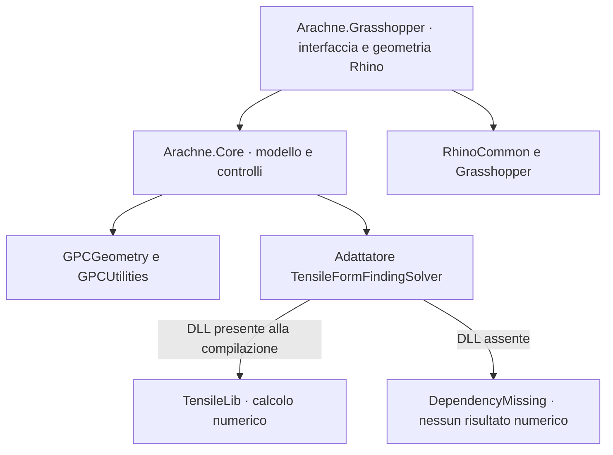

# Architettura iniziale

Arachne.Core usa GPCGeometry per punti, vettori e piani e GPCUtilities per le conversioni di unità. Non dipende da Rhino, Grasshopper, SAP o Straus. Arachne.Grasshopper converte la geometria Rhino nel modello Core e visualizza gli esiti. I generatori di reti rimangono nel progetto Grasshopper perché utilizzano intersezioni, curve, mesh e Brep di Rhino.

## Dati

- `Cable`: estremi, obiettivo di ricerca di forma, vincoli opzionali, area, densità e forze concentrate.
- `NodeCondition`: punto, vincoli traslazionali, forza e pesi XYZ non lineari.
- `FormModel`: nodi unificati, cavi con indici di connessione e facce opzionali triangolari/quadrangolari.
- `SolverSettings`: tipo di calcolo, limiti e tolleranze, pressione, gravità e piano.
- `FormResult`: stato, messaggi, numero di chiamate al solutore, coordinate, forze, densità di forza e facce.

ModelBuilder registra immediatamente ogni nodo nuovo nella tabella spaziale. La fusione usa una tolleranza geometrica; le condizioni devono corrispondere agli estremi dei cavi, quindi un punto appoggiato nel mezzo di un cavo richiede prima la suddivisione del cavo. Cavi duplicati o collassati e facce degeneri vengono rifiutati. I valori in ingresso vengono copiati, senza modificare i cavi a monte.

## Calcolo

L'adattatore ricostruisce un modello TensileLib a ogni richiesta. Per il modo Linear iterative usa un ciclo esterno limitato e aggiorna le densità rispetto a lunghezza e forza prescritte. Gli esiti non riconosciuti, le eccezioni e la mancata convergenza non producono geometria di risultato. I messaggi della preparazione vengono mantenuti.

La cancellazione è verificata prima e dopo ogni chiamata a TensileLib: non interrompe una singola chiamata interna già avviata. La prima interfaccia Grasshopper esegue il calcolo in modo sincrono con un booleano Run; l'esecuzione asincrona con pulsante di annullamento è un'estensione futura.

## Confini della prima versione

Il progetto contiene l'interfaccia dei tre modi osservati in FeMM, non una reimplementazione matematica di TensileLib. Finché la DLL manca, il ramo dell'adattatore numerico è escluso dalla compilazione. La generazione automatica delle facce da parte del motore, le convenzioni della pressione, i pesi e il comportamento di convergenza devono essere confrontati con la DLL reale.

Flattening, geodetiche, compensazione dei pannelli 2D, verifiche di resistenza e scambio con programmi FEM non appartengono a questo primo nucleo. La compensazione della lunghezza dei singoli cavi è invece inclusa in Cable Constraints.
