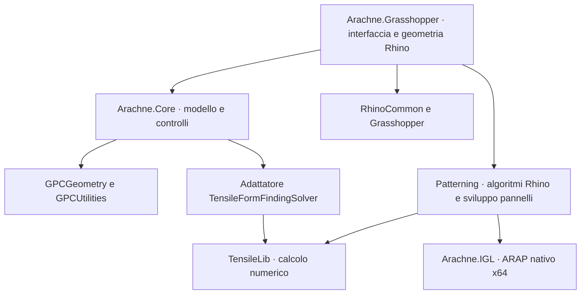

# Architettura dopo il trasferimento

Arachne.Core usa GPCGeometry per punti, vettori e piani e GPCUtilities per le conversioni di unità. Non dipende da Rhino, Grasshopper, SAP o Straus. Arachne.Grasshopper converte la geometria Rhino nel modello Core e visualizza gli esiti. I generatori di reti rimangono nel progetto Grasshopper perché utilizzano intersezioni, curve, mesh e Brep di Rhino.

## Dati

- `Cable`: estremi, obiettivo di ricerca di forma, vincoli opzionali, area, densità e forze concentrate.
- `NodeCondition`: punto, vincoli traslazionali, forza e pesi XYZ non lineari.
- `FormModel`: nodi unificati, cavi con indici di connessione e facce opzionali triangolari/quadrangolari.
- `SolverSettings`: tipo di calcolo, limiti e tolleranze, pressione, gravità e piano.
- `FormResult`: stato, snapshot del modello iniziale e impostazioni, storia reale delle iterazioni e SolvedModel con record di nodi/aste/piastre. Le liste originarie restano per compatibilita.

ModelBuilder registra immediatamente ogni nodo nuovo nella tabella spaziale. La fusione usa una tolleranza geometrica; le condizioni devono corrispondere agli estremi dei cavi, quindi un punto appoggiato nel mezzo di un cavo richiede prima la suddivisione del cavo. Cavi duplicati o collassati e facce degeneri vengono rifiutati. I valori in ingresso vengono copiati, senza modificare i cavi a monte.

## Calcolo

L'adattatore ricostruisce un modello TensileLib a ogni richiesta. Per il modo Linear iterative usa un ciclo esterno limitato e aggiorna le densità rispetto a lunghezza e forza prescritte. Gli esiti non riconosciuti, le eccezioni e la mancata convergenza non producono geometria di risultato. I messaggi della preparazione vengono mantenuti.

La cancellazione e verificata anche tra le iterazioni interne di TensileLib. Una singola operazione algebrica resta non interrompibile. Form Find conserva il modo sincrono e aggiunge Background e Cancel; gli aggiornamenti di Grasshopper avvengono sul thread dell'interfaccia e i risultati delle richieste superate vengono scartati.

## Confini della prima versione

Il progetto contiene l'interfaccia dei tre modi osservati in FeMM, non una reimplementazione matematica di TensileLib. Il plugin completo richiede TensileLib e ARAP; il Core isolato conserva un ramo diagnostico senza motore. I tre modi sono stati verificati con equilibri analitici reali. Pressioni, peso proprio, membrane e pesi combinati richiedono una campagna di confronto piu ampia.

Flattening, geodetiche, compensazione dei pannelli 2D e strumenti mesh sono inclusi in Components/Patterning. ARAPHelper traduce i dati per il C ABI della DLL nativa e adegua la scala dei pin alla versione 0.9.0. Compensation, Decompensation e Flattening sono ora servizi separati in Services/, senza accesso a Grasshopper o a RhinoDoc; le classi dei componenti raccolgono gli ingressi, passano le tolleranze e visualizzano gli esiti. GUID e porte restano invariati. Le verifiche di resistenza e lo scambio con programmi FEM restano fuori dallo scopo.

La specifica attuale di modello, risultati, pressioni e unita e in [RESULTS.md](RESULTS.md); il registro della prima release e in [RELEASE-1.md](RELEASE-1.md).
