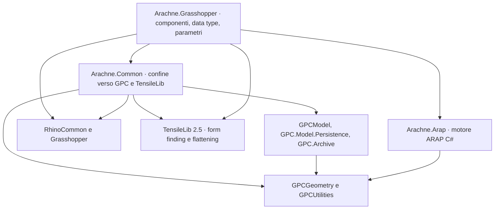

# Architettura

Dalla 0.4.0 i dati del modello sono oggetti GPC (GPCModel): il modello FEM preso da FeMM non c'è più. Arachne converte solo la geometria Rhino in geometria GPC e le unità scelte in Build Model in N, mm, s, t.

## Arachne.Common

Il confine tra Grasshopper, GPC e TensileLib:

- `Analysis/ElementDrafts` e `Analysis/ModelBuilder`: le bozze degli elementi (nelle unità del documento, come in FeMM) e il loro assemblaggio di Build Model in un `Model` GPC in N-mm. Gli elementi con lo stesso GUID si uniscono, poi i nodi coincidenti entro la tolleranza delle impostazioni, con la numerazione di FeMM (ID utente, poi 1, 2, …). Gli obiettivi del form finding stanno sulle aste e sui nodi come attributi GPC (`FormFindingGoalAttribute`, `FormFindingCoordinateAttribute`), l'ID di Element Id come `ElementLabelAttribute`.
- `Analysis/FormFindingUnits`: unità del documento (kNm, SI, Nmm, IPS) e unità del solutore; in IPS la massa del solutore è lbf·s²/in.
- `Analysis/FormFindingInputBuilder`, `TensileModelAdapter`, `FormFindingOutputProjection`: il grafo d'analisi (copia del modello con gli obiettivi in `Model.FormFinding`), l'esportazione verso TensileLib, lineare nel numero degli elementi, il calcolo, i risultati riattaccati al grafo e il modello di uscita nelle unità del documento.
- `Analysis/FormFindingOptions`: le opzioni di Solver Options (`FormFindingDefinition` GPC, casi scelti, pressione, mesh, proprietà delle piastre generate).
- `Analysis/SharedCopies`: le copie dei dati GH condividono proprietà, materiali, sezioni e sistemi di riferimento, che nessun componente modifica; gli elementi e il modello restano copie vere.
- `Helpers/ContractArchive`: i byte dei dati internalizzati (`ARCGPC3`, archivio GPC compatto). I vecchi payload BinaryFormatter della 0.3 sono rifiutati con un messaggio esplicito.
- `Helpers/ModelChecks`: controlli di Check Model (vincoli per parte e direzione, aste senza forza, valori non validi).
- `Helpers/FormFindingHelper`: reti di curve in modelli e mesh (Cable Net, Curve2Mesh).
- `Geometry/SectionCalculator` e `Geometry/Shapes`: contorno e proprietà delle sezioni, sugli stessi numeri di FeMM, su GPCGeometry.

La serie 0.3.0 usa ancora BinaryFormatter. Compatibilità dei runtime, controlli
degli archivi e strategia per il successivo formato GPC sono documentati in
[RUNTIME-AND-ARCHIVES](RUNTIME-AND-ARCHIVES.md).

## Arachne.Grasshopper

- `DataTypes`: wrapper Grasshopper degli oggetti GPC (`GH_Model`, `GH_Node`, `GH_Beam`, `GH_Plate`, proprietà, sezioni, materiali, casi di carico, opzioni). Ogni nodo, asta e piastra ha un GUID, dato dal componente e dall'indirizzo dell'uscita.
- `Components`: un file per componente, nelle cartelle FeMM (Analysis, Attributes, Definitions, ElementProperties, Loads, Materials, Models, Parameters, Patterning, Sections, Tools).
- `ComponentAttributes`: pulsante Run di Form Find e immagini dei componenti di carico.
- `Helpers/AnalysisDocumentState`: i calcoli del Form Find nel documento. Ogni calcolo si prepara in background mentre si proiettano le uscite; al salvataggio va nel file `<documento>.<InstanceGuid>.gpc-results` accanto al `.gh` (`ExternalModelArchive` di GPC), e nel `.gh` restano i riferimenti. Copia e incolla e Annulla portano un pacchetto dentro i dati.
- `Services`: algoritmi di Compensation, Decompensation e Flattening separati dai componenti.
- `Geometry`: generatori Cable Net (CableNetHelper) e geodetiche su mesh.
- `Helpers/ARAPHelper`: conversione tra mesh Rhino e motore `Arachne.Arap`.
- `PluginBuildCheck`: controllo al caricamento, copia identica di quella di BridGHe. Segnala un bin compilato da un altro commit del checkout e librerie condivise (GPC*, DelaunayMesh, TensileLib) caricate da un altro plug-in con contenuto diverso.

## Form Find

Form Find costruisce a ogni esecuzione il grafo d'analisi dal modello di Build Model e dalle opzioni di Solver Options (senza, valgono i predefiniti), lo esporta in un modello TensileLib e chiama il solutore scelto. Si applicano i soli carichi dei casi scelti; ogni piastra ha spessore e densità della sua Plate Property, da cui TensileLib calcola il peso proprio della membrana.

- **Linear**: densità di forza lineare;
- **Linear step by step**: ciclo esterno che corregge le densità fino a lunghezze e forze fisse;
- **Non-Linear**: obiettivi pesati.

TensileLib risolve il modello con il centro nell'origine e poi lo riporta al suo posto. Il risultato è una copia del modello in ingresso con:

- le posizioni calcolate;
- il pre-carico di trazione sulle aste con Force Density, Fixed Axial Force o Fixed Length;
- i carichi nodali della pressione nel caso di carico indicato (un nuovo Form Find non li applica e li sostituisce);
- le reazioni dei vincoli, solo nelle direzioni vincolate, se il calcolo converge;
- la mesh delle piastre.

I risultati sono legati al grafo esportato dalla sua impronta GPC: riaprendo il documento, Form Find rimette le uscite del calcolo salvato solo se modello e impronta sono quelli degli ingressi attuali. Beam Forces e Support Reactions leggono pre-carichi e reazioni dal modello; Check Model usa `ModelChecks` prima del calcolo.

## Verifiche

`tools/Arachne.ExampleWriter` avvia Rhino 8 in-process senza finestra e usa i componenti in documenti Grasshopper reali:

- `InventoryChecks`: GUID, icone e confronto di ingressi e uscite con i sorgenti FeMM;
- `F6ContractsChecks`: contratti GPC dei dati GH e loro archivi, rifiuto dei vecchi payload, confine delle unità di Build Model, diagnostiche GPC, file accanto del Form Find e ripristino, esportazione lineare, proprietà condivise;
- `FormFindingChecks`: form finding su casi analitici in N/mm, unione dei rami, carichi sulle aste, reazioni, vincoli lungo gli assi di un piano, peso proprio in N/mm, in SI e in IPS, pressione anche ricalcolata, predefiniti senza Solver Options, casi di carico, peso delle piastre bilanciato dalle reazioni, modelli lontani dall'origine, Check Model, filtri, Membrane Material e Plate Property, anteprima delle sezioni, serializzazione;
- `PatterningChecks`: sviluppo e compensazione dei pannelli, ARAP, decompensazione, strumenti sulle mesh e Panel Distortion, con valori attesi (lati, aree, distanze); una prova unica verifica che nessun componente modifichi la mesh in ingresso;
- `NetworkChecks`: reti di cavi rettangolari, radiali e composte, con il numero di cavi, di pezzi di perimetro e di punti interni, con e senza tolleranza di corrispondenza.
- `ExampleArchiveChecks`: apertura dei sei file GH/GHX distribuiti, ricalcolo e
  nuovo salvataggio/apertura su copie temporanee, con controlli geometrici.

`tools/Arachne.Compare` non cita Arachne: costruisce le definizioni per GUID e indice delle porte, quindi gira su qualsiasi versione del plug-in e confronta ogni numero bit per bit (`run`, poi `diff`). Con `examples` apre gli esempi, li risalva e li ripristina; con `loadcheck` prova il controllo al caricamento con altre copie delle librerie caricate prima.

Il motore ARAP ha una suite propria, `tests/Arachne.Arap.Tests` (54 controlli), con il confronto facoltativo con la DLL nativa della prima versione.

Gli esempi in `examples/` vengono generati dallo stesso strumento, riaperti e ricalcolati.
