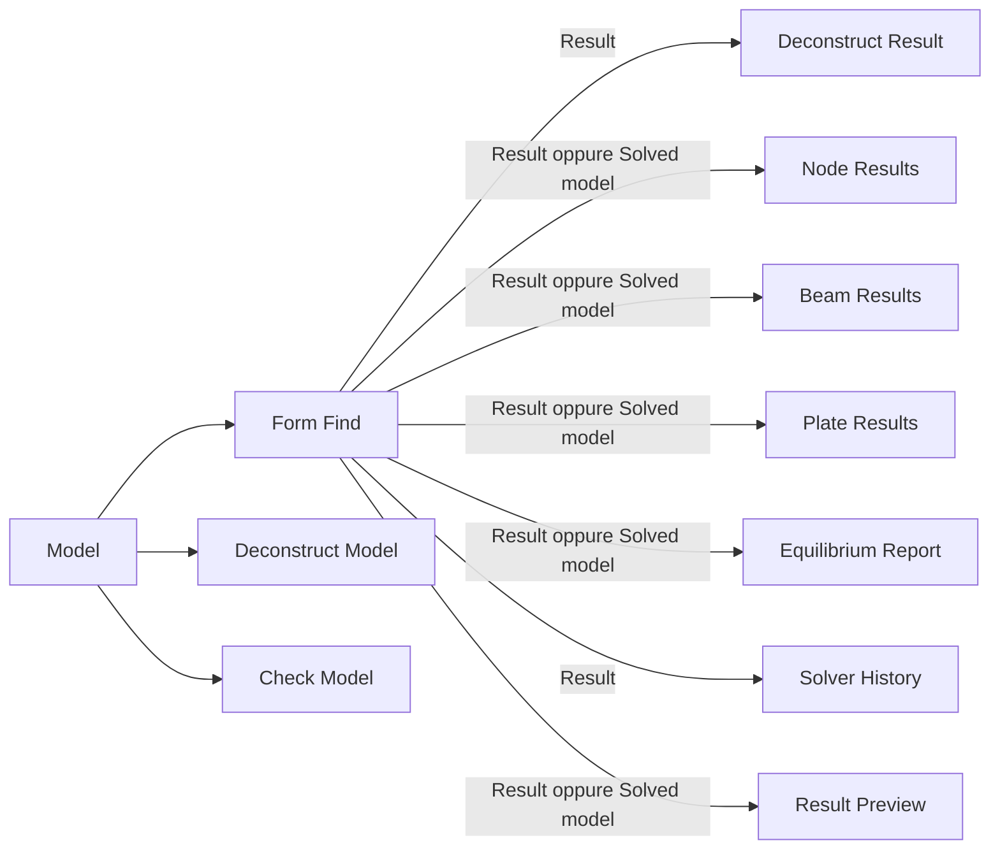

# Modello e interrogazione dei risultati

## Come sono conservati

`Model` produce un `FormModel` con identita GUID e ID interi a partire da 1 per nodi e aste. La connettivita interna usa indici a partire da 0; le porte dei nuovi componenti espongono ID a partire da 1. Gli ID restano associati allo stesso modello durante il calcolo. Ricostruire il modello produce una nuova identita: non confrontare elementi di modelli diversi soltanto per numero.

`Form Find` produce due nuove uscite, aggiunte dopo le nove esistenti:

- **Result**, indice 9: `FormResult`, con copia del modello iniziale e delle impostazioni, stato, messaggi e storia delle iterazioni. E presente anche per un calcolo fallito o annullato che abbia raggiunto il solver.
- **Solved model**, indice 10: `SolvedModel`, presente solo dopo convergenza. Contiene collezioni protette di `NodeResult`, `BeamResult` e `PlateResult`. Le coordinate e i vettori restituiti sono copie; modificare un punto a valle non cambia il risultato conservato.

Le vecchie liste di posizioni/forze restano disponibili per compatibilita, ma le nuove interrogazioni usano il risultato strutturato indipendente da quelle liste. `Create mesh=False` disabilita soltanto la mesh di visualizzazione: le piastre del motore rimangono interrogabili.

I dati sono **in memoria durante la sessione Grasshopper**. Non e stato introdotto un archivio permanente dei risultati ne una serializzazione degli oggetti internalizzati: salvare i collegamenti e gli ingressi e ricalcolare dopo la riapertura. Non viene modificato il documento Rhino e non vengono create geometrie tramite Bake.

## Collegamenti

Lasciare vuoto l'ingresso IDs per ottenere tutti gli elementi. Gli ID selezionati devono esistere e non essere ripetuti; l'ordine della selezione e mantenuto. Gli alberi di vincoli e connessioni hanno percorso `{ID}`.

`Deconstruct Model` descrive il modello iniziale, anche quando riceve Result. `Deconstruct Result` distingue il modello iniziale da quello risolto. I componenti Node/Beam/Plate Results ricevono direttamente Result oppure Solved model.

## Nodi

Node Results restituisce posizione risolta, spostamento dalla posizione iniziale, vincoli, carico esterno totale, reazione e residuo. Espone separatamente le forze nodali dirette, il peso proprio dei cavi, i carichi concentrati dei cavi e la pressione equivalente.

Per ogni asta da a a b, con densita q, la forza interna sul nodo a e `q*(x_b-x_a)` e quella sul nodo b ha verso opposto. Il residuo prima delle reazioni e la somma di forze interne ed esterne. Sulle componenti vincolate la reazione applicata al modello e l'opposto di questa somma; sulle componenti libere resta il residuo di equilibrio. Queste reazioni sono ricavate dall'equilibrio della rete, non lette da un risultato FEM di piastra.

Equilibrium Report verifica separatamente:

1. massimo modulo del residuo libero nodale;
2. modulo della somma di carichi e reazioni;
3. modulo del momento risultante rispetto all'origine scelta.

Le tolleranze sono assolute, rispettivamente N e N*m; i default 1e-4 sono modificabili. La convergenza numerica del solver non equivale automaticamente al superamento di queste verifiche. Non viene certificata la stabilita della configurazione.

## Aste

Beam Results restituisce ID, estremi mediante ID nodali, asse risolto, lunghezza iniziale/finale, forza assiale N e densita q=N/L in N/m. Il segno positivo indica trazione. I record conservano anche tipo/valore dell'obiettivo e direzione di membrana. Eventuali forze negative generano un avviso: il motore non e stato trasformato in un solver tension-only con disattivazione automatica degli elementi compressi.

## Piastre e tiri

Plate Results restituisce ID, vertici ordinati, mesh della singola faccia, area iniziale e finale e un valore per ciascun lato, nell'ordine dei vertici:

- ID dell'asta di bordo;
- forza assiale della stessa asta **in N**.

Per un lato senza asta sono restituiti ID 0 e forza NaN. La disponibilita del dato e quindi distinguibile da un tiro effettivamente nullo. Gli ID di piastra seguono l'ordine delle facce del motore nella singola soluzione; per facce esplicite seguono l'ordine fornito a Model.

**Questi valori non sono Nx, Ny, Nxy.** TensileLib non espone un tensore risolto di membrana; `Plate.SumStresses` e un dato di ingresso. Anche il vecchio Form Find aggiornava soltanto la geometria delle piastre e la pretensione delle aste. Per questo l'uscita Membrane results available e False, accompagnata dalla spiegazione. Non vengono prodotti falsi zeri per tensioni assenti.

Il modo Membrane mantiene la conversione originaria di TensileLib tramite aree di competenza/area media e lunghezze delle aste. E verificato il trasferimento numerico di quel comportamento su una rete regolare; non e una nuova formulazione continua o una validazione generale della pretensione di una membrana. Un recupero di Nx/Ny/Nxy richiede definire assi locali, discretizzazione, spessore quando si desiderano tensioni in Pa, ed equivalenza energetica/equilibrio, poi confrontarlo con casi teorici.

## Pressione, unita e pannelli

La pressione positiva agisce lungo la normale data dall'ordine dei vertici. I triangoli ricevono forze nodali consistenti; i quad sono suddivisi lungo la diagonale primo-terzo vertice. Invertire l'ordine dei vertici inverte il carico. La nuova convenzione sostituisce la vecchia stima limitata ai nodi con almeno quattro aste e orientata forzatamente verso Z positivo.

Unit Settings e Convert Units usano GPCUtilities con destinazioni esplicite m/N/kg. Le quantita composte derivano dalle unita scelte: ad esempio kN/mm2 viene convertito in Pa, non interpretato come kPa. Le coordinate Rhino non sono convertite automaticamente: usare il fattore di lunghezza in uscita per scalare la geometria prima di Model.

Panel Distortion confronta mesh con identici indici di vertice e identica topologia. Restituisce variazioni firmate `(finale/iniziale)-1` di lunghezze e aree, non percentuali gia moltiplicate per 100. Le soglie predefinite 0.02 e 0.04 sono criteri geometrici modificabili, non limiti ammissibili del tessuto. Per quad l'area segue la diagonale primo-terzo vertice.

## Calcoli lunghi

Form Find mantiene Run all'indice 2 e aggiunge Background all'indice 3 e Cancel all'indice 4. Il default e sincrono per compatibilita. Con Background=True il canvas resta disponibile; vengono mostrati gli indici di avanzamento. Il cambiamento degli ingressi scarta il risultato precedente e avvia un nuovo calcolo; Run=False annulla e svuota. Dopo una cancellazione usare Run=False e poi True per ripartire.

Il modo Background accetta un modello e un insieme di impostazioni; gli alberi con piu modelli richiedono il modo sincrono. Non sono pubblicati risultati parziali come convergenti. La cancellazione e cooperativa tra le iterazioni del motore e non interrompe a meta una chiamata algebrica interna. I componenti Patterning/ARAP rimangono sincroni.

Solver History contiene passi interni effettivi, chiamata esterna, criterio e tempo trascorso. Il criterio lineare e l'incremento relativo di posizione; quello non lineare/planare e il residuo algebrico relativo con quantita miste. Non leggere quei numeri come residui fisici in N: per quelli usare Node Results ed Equilibrium Report.
